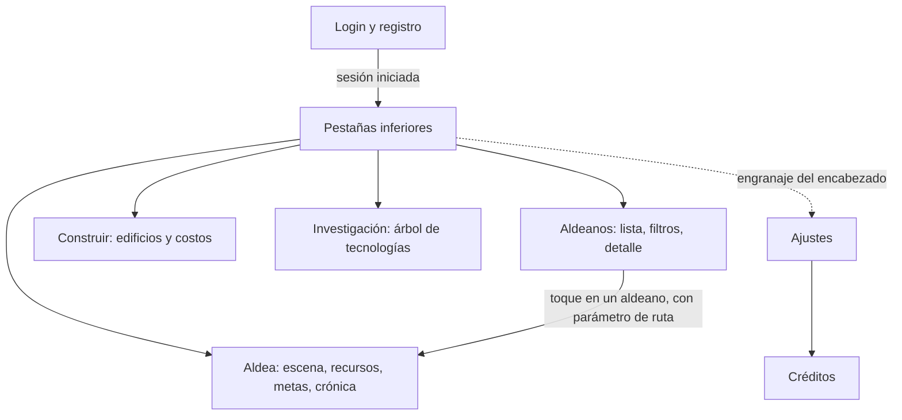

# Bitácora de Diseño y Frontend Móvil · Vilai

**Estudiante:** Francisco José Kroff Inzunza · **Asignatura:** Tecnologías Web y Móviles (6.º semestre) · **Carrera:** Ingeniería Civil en Informática, Universidad de Los Lagos

- **Repositorio:** https://github.com/FranciscoJoseKroff/VilaiAPP
- **Diseño en Figma / Penpot:** 
- **Cómo ejecutar:** ver el `README.md` del repositorio

## 1. Identidad de marca y UI Kit base

### 1.1 Nombre y propósito

- **Nombre:** Vilai.
- **Qué es:** un juego incremental de construcción de aldea para móviles. La población y la economía evolucionan de forma semi-autónoma mientras el jugador construye, investiga y toma decisiones; los aldeanos eligen su oficio según lo que la aldea necesita.
- **Problema que resuelve:** los juegos de construcción de pueblos suelen exigir gestión activa y constante, lo que genera fricción en el público casual de móviles, que busca sesiones cortas y sensación de progreso incluso cuando no mira la pantalla. Vilai hace que la aldea crezca sola y calcula el progreso fuera de línea (con un tope de 8 horas).

### 1.2 Logo

El logo es una casa en pixel art con una chispa que sugiere autonomía. Está construido con cuadrados, por lo que es **vectorial** y se escala sin perder nitidez; usa solo colores de la paleta.

| Versión | Archivo | Uso |
|---|---|---|
| Logo (solo símbolo) | [`img/logo.svg`](img/logo.svg) | Documentos, Figma, README |
| Logo horizontal con nombre | [`img/logo-horizontal.svg`](img/logo-horizontal.svg) | Portada, presentaciones |
| Ícono de app 1024 × 1024 | `assets/icon.png` (copia en [`img/icono-1024.png`](img/icono-1024.png)) | iOS, Android, tiendas |
| Ícono adaptativo (Android) | `assets/android-icon-foreground.png`, `android-icon-background.png`, `android-icon-monochrome.png` | Máscaras de Android 8+ y íconos temáticos |
| Pantalla de carga (splash) | `assets/splash-icon.png` | Arranque de la app |
| Favicon web | `assets/favicon.png` | Navegador (PWA) |

**Legibilidad a 48 px:** el símbolo usa formas grandes y pocos colores (techo dorado, paredes crema, puerta oscura, chispa turquesa), de modo que se reconoce incluso en tamaños pequeños. Prueba: [`img/icono-48px.png`](img/icono-48px.png).

### 1.3 Paleta de colores

Los colores están centralizados en `theme.js` (objeto `colors`).

**Primaria** (verde bosque y dorado)

| Nombre en código | HEX | Uso |
|---|---|---|
| `fondo` | `#0d1f1a` | Fondo de pantallas |
| `superficie` | `#12281f` | Tarjetas y paneles |
| `superficieAlta` | `#263f34` | Elementos elevados |
| `acento` | `#e7b85c` | Botones primarios y elementos destacados |

**Secundaria** (colores de contexto del juego)

| Contexto | HEX |
|---|---|
| Primavera | `#8ab96d` |
| Verano | `#f5c762` |
| Otoño | `#d57957` |
| Invierno | `#79b9bd` |
| Edad de la Ceniza | `#9b5961` |
| Edad de las Sombras | `#76629a` |
| Edad de los Descubrimientos | `#47728b` |

**Neutros**

| Nombre | HEX | Uso |
|---|---|---|
| `textoPrimario` | `#f2ede0` | Texto principal |
| `textoSecundario` | `#9fb8ae` | Texto de apoyo |
| `placeholder` | `#a4b8af` | Marcadores de campos |
| `borde` | `#244536` | Bordes decorativos |

**Semánticos**

| Nombre | HEX | Significado |
|---|---|---|
| `exito` | `#7fd3b3` | Acción posible o completada |
| `peligro` | `#f28b82` | Error o riesgo |
| `aviso` | `#f2b09a` | Advertencia |

**Justificación (borrador, revisar y reescribir con tus palabras):**
- **Tema oscuro verde bosque:** el juego se juega en sesiones cortas y en movimiento, a menudo con poca luz; un fondo oscuro reduce el deslumbramiento y hace resaltar los colores de la escena. El verde refuerza el tema de aldea y naturaleza.
- **Dorado como acento único de acción:** todo lo que se puede tocar para avanzar (construir, mejorar, investigar) usa el mismo dorado, así el usuario aprende una sola regla visual.
- **Colores secundarios por estación y edad:** el jugador reconoce el momento del juego por el color del encabezado y el cielo sin leer texto.
- **Semánticos:** verde azulado para "se puede / se logró", rojo suave para "falta o riesgo" y naranja claro para avisos. Nunca se usa el color como único indicador: siempre va acompañado de texto o icono.

### 1.4 Contraste (WCAG AA)

Razones calculadas con la fórmula de luminancia relativa de WCAG 2.x:

| Par (texto sobre fondo) | Razón | Resultado |
|---|---|---|
| Texto principal sobre `fondo` | 14,63 : 1 | AA ✔ |
| Texto principal sobre `superficie` | 13,32 : 1 | AA ✔ |
| Texto secundario sobre `fondo` | 8,10 : 1 | AA ✔ |
| Texto secundario sobre `superficie` | 7,37 : 1 | AA ✔ |
| Texto secundario sobre `superficieAlta` | 5,39 : 1 | AA ✔ |
| Placeholder sobre `superficie` | 7,45 : 1 | AA ✔ |
| Acento dorado sobre `fondo` | 9,29 : 1 | AA ✔ |
| Texto oscuro sobre botón dorado | 9,29 : 1 | AA ✔ |
| `exito` sobre `fondo` | 9,67 : 1 | AA ✔ |
| `peligro` sobre `fondo` | 7,16 : 1 | AA ✔ |
| `aviso` sobre `fondo` | 9,33 : 1 | AA ✔ |
| `borde` sobre `fondo` | 1,61 : 1 | 

### 1.5 Escala tipográfica

Definida en `theme.js` (`typography`):

| Estilo | Fuente | Tamaño / interlineado |
|---|---|---|
| Título | Press Start 2P | 20 / 28 |
| Cifra | Press Start 2P | 24 / 32 |
| Cuerpo | Inter Regular | 16 / 24 |
| Cuerpo en negrita | Inter Bold | 16 / 24 |
| Etiqueta | Inter | 14 |

La fuente pixel se usa solo en títulos y cifras (identidad de videojuego retro); el texto largo va en Inter a 16 sp para mantener la legibilidad. 

---

## 2. Arquitectura y flujo de usuario

### 2.1 Usuario y caso de uso principal

- **Usuario objetivo (supuesto de diseño, no resultado de una encuesta):** jugador casual de móvil que juega en momentos sueltos (transporte, pausas) y quiere avanzar sin vigilar el juego todo el tiempo.
- **Caso de uso principal:** abrir la aldea, ver cómo evolucionó, dirigir a los aldeanos, construir o mejorar con pocos toques, resolver un evento y cerrar la app sabiendo que todo queda guardado.

### 2.2 Storyboard (6 viñetas)

| Viñeta | Contexto y resolución |
|---|---|
| 1 | En el bus, con una mano ocupada y pocos minutos. **Problema:** los juegos de aldea exigen gestión constante. |
| 2 | Abre Vilai: la aldea siguió trabajando mientras no estaba (progreso offline calculado por el servidor, con tope de 8 h). |
| 3 | Con el pulgar revisa a los aldeanos y activa **Auto**: ellos eligen el oficio. |
| 4 | Construye o mejora desde la barra inferior, viendo en verde o rojo qué recursos alcanzan o faltan. |
| 5 | Llega un evento (helada, bestias): aviso previo y decisión con un toque. |
| 6 | Guarda el teléfono: la aldea sigue creciendo y el estado queda en la nube. **Resolución del problema.** |

### 2.3 Mapa de navegación

Estructura de Expo Router (`src/app`):

| Archivo | Rol |
|---|---|
| `src/app/_layout.js` | Layout raíz: proveedor de zonas seguras y carga de recursos |
| `src/app/(tabs)/_layout.js` | Layout de pestañas; muestra el login si no hay sesión |
| `src/app/(tabs)/index.js` | Pestaña Aldea |
| `src/app/(tabs)/aldeanos.js` | Pestaña Aldeanos |
| `src/app/(tabs)/construir.js` | Pestaña Construir |
| `src/app/(tabs)/investigacion.js` | Pestaña Investigación |
| `src/app/(tabs)/ajustes.js` | Ajustes (sonido, reducir animaciones, cerrar sesión) |
| `src/app/creditos.js` | Pantalla de créditos (pila sobre las pestañas) |

---

## 3. Evolución visual

Wireframes de baja fidelidad en escala de grises, en marcos de 390 × 844 pt, con zonas seguras (notch y barra de gestos) y zona fácil del pulgar marcadas.

| Pantalla | Wireframe (baja fidelidad) | Mockup (alta fidelidad) | App implementada |
|---|---|---|---|
| Login | [`wf-login`](img/wf-login.png) 
| Aldea | [`wf-aldea`](img/wf-aldea.png) 
| Aldeanos | [`wf-aldeanos`](img/wf-aldeanos.png) 
| Construir | [`wf-construir`](img/wf-construir.png) 
| Investigación | [`wf-investigacion`](img/wf-investigacion.png) 

   

**Qué cambió entre los wireframes y la app (verificado en las capturas del juego):**
- Se agregó un **HUD superior fijo** con los recursos principales y la población, visible en todas las pestañas.
- La escena de la aldea ganó **zoom y desplazamiento** (botones + y −).
- Las tarjetas de recurso muestran un estado **"Lleno"** y el efecto de la estación.
- La tarjeta de tiempo incorporó la **edad** del juego y la crónica ("Ver más").
- Se añadieron sonido, animaciones y una guía de primera vez.

---

## 4. Evidencia del frontend

**Stack:** Expo SDK 58, React Native 0.88, React 19, Expo Router. Servidor: Node.js, Express y MongoDB (Mongoose) con autenticación JWT.

| Pantalla | Archivo | Interacción real |
|---|---|---|
| Login y registro | `src/screens/LoginScreen.js` | Campos de texto controlados, alternancia entre iniciar sesión y registrarse, errores del servidor |
| Aldea | `src/app/(tabs)/index.js` | Escena con zoom y desplazamiento, recursos, metas, crónica |
| Aldeanos | `src/app/(tabs)/aldeanos.js` | `FlatList`, filtros por oficio, "Poner a todos en Auto", detalle con "Por qué lo hizo" |
| Construir | `src/app/(tabs)/construir.js` | Construir y mejorar con chips de costo y motivo si no se puede |
| Investigación | `src/app/(tabs)/investigacion.js` | Nodos con estado, nodo "Sugerido", "Bonos activos", investigar |
| Ajustes | `src/app/(tabs)/ajustes.js` | Sonido, reducir animaciones, créditos, cerrar sesión |

---

## 5. Justificación técnica y ergonómica

**Jerarquía visual.** Los títulos y las cifras de recursos usan la fuente pixel y un tamaño mayor; el texto de apoyo va en Inter a 16 sp con colores de menor énfasis. El color dorado queda reservado para la acción principal de cada pantalla.

**Tamaño y ubicación de los elementos táctiles.**
- El componente `PixelButton` fija un alto y ancho mínimos de **44 pt**, y se usa en las acciones principales.
- La navegación principal está en la **barra de pestañas inferior**, dentro de la zona fácil del pulgar, y los botones de acción de las tarjetas ocupan todo el ancho en la parte baja de la tarjeta (ver wireframes).
- El contenido respeta el notch y la barra de gestos: `SafeAreaProvider` en el layout raíz y `SafeAreaView` con bordes superior e inferior.

**Reducción de la carga cognitiva (heurísticas de Nielsen).**

| Heurística | Cómo se aplica en Vilai |
|---|---|
| Visibilidad del estado | Estación, año y edad siempre visibles; barras de progreso; avisos de evento; recursos con "Lleno" |
| Prevención de errores | Los botones deshabilitados muestran el motivo ("Faltan recursos", "Requiere: …") |
| Reconocer en vez de recordar | Chips de costo con icono y color (verde alcanza, rojo falta); filtros por oficio visibles |
| Consistencia | Un único sistema de tokens (`theme.js`) y componentes reutilizables (`PixelPanel`, `PixelButton`, `PixelBar`) |
| Control y libertad | La guía de primera vez se puede saltar; interruptores para el sonido y para reducir animaciones |
| Ayuda al usuario | El panel "Por qué lo hizo" explica la decisión de cada aldeano con sus factores |

**Accesibilidad.** Hay etiquetas y roles de accesibilidad en los elementos interactivos (61 etiquetas y 58 roles en el código), los textos cumplen contraste AA (sección 1.4) y existe la opción de reducir animaciones.

---

## 6. Bitácora de IA generativa

### 6.1 Herramientas utilizadas

| Herramienta | Para qué la usé |
|---|---|
| **Claude** (asistente conversacional de Anthropic) | Planificar el trabajo por fases, redactar los prompts, revisar el código y los errores que aparecieron, buscar documentación y librerías, y preparar documentación |
| **GitHub Copilot** (modo agente en VS Code) | Implementar el código siguiendo los prompts por fases |

### 6.2 Prompts principales

Los prompts completos están en el repositorio, en [`docs/prompts/`](prompts/). 

| # | Etapa | Archivo de prompts | Resultado | Captura |
|---|---|---|---|---|
| 1 | Mejora de UX/UI (fases 0 a 9) | [`01-mejora-ux-ui.md`](prompts/01-mejora-ux-ui.md) | Pestañas, tokens de diseño, tarjetas, accesibilidad | 
| 2 | Sistema de tiempo | [`02-sistema-de-tiempo.md`](prompts/02-sistema-de-tiempo.md) | Años, estaciones y edades | 
| 3 | IA de aldeanos (IA-1 a IA-4) | [`03-ia-de-aldeanos.md`](prompts/03-ia-de-aldeanos.md) | Decisión con factores, panel "Por qué lo hizo", frases | 
| 4 | Árbol de investigación (T1 a T3) | [`04-arbol-de-investigacion.md`](prompts/04-arbol-de-investigacion.md) | Catálogo de datos, módulo de efectos, vista de árbol |
| 5 | Interfaz fresca (UI-1 a UI-6) | [`05-interfaz-fresca.md`](prompts/05-interfaz-fresca.md) | Fuentes, componentes pixel, animaciones, iconos, sonido | 
| 6 | Despliegue y seguridad | [`06-despliegue-y-seguridad.md`](prompts/06-despliegue-y-seguridad.md) | Límites de peticiones, validación de entorno, CORS | 

**Estado del trabajo:** las fases de UX/UI, el sistema de tiempo, la IA de aldeanos (IA-1 a IA-4), el árbol hasta T3, la interfaz fresca y la seguridad del servidor están aplicadas. Las fases T4 a T8 del árbol no se aplicaron y E1a está en curso.

### 6.3 Qué se aceptó, qué se corrigió y por qué

Cada fila es un caso real del proyecto, con el hallazgo y la decisión. 

| # | Problema o alucinación | Cómo se detectó | Qué se decidió | Estado |
|---|---|---|---|---|
| 1 | Texto con codificación rota (`→`, `Ã`) en la interfaz | Lectura del código | Corregir la codificación y pasar los iconos a una librería de iconos | Corregido |
| 2 | Credenciales reales de la base de datos en `.env.example` | Revisión del repositorio antes de publicarlo | Crear usuarios nuevos con permisos mínimos y borrar el usuario antiguo |
| 3 | Los bonos de investigación estaban escritos a mano en varios lugares | Lectura del código | Centralizarlos en un módulo de efectos con pruebas (T1) | Corregido |
| 4 | El esquema de Mongoose tenía campos fijos para las tecnologías: las nuevas se habrían descartado al guardar | Revisión del esquema antes de implementar | El prompt T1 exige una prueba de guardar y leer | Corregido |
| 5 | La escena (Skia) fallaba en web: `Failed to set an indexed property [0] on 'CSSStyleDeclaration'` | Consola del navegador en el build de producción | Pasar el estilo del `Canvas` como objeto con `StyleSheet.flatten`, no como lista | Corregido |
| 6 | El guardado fallaba con 400: `vagar` no era un valor válido de `estado` | Respuesta del servidor | Separar el estado del oficio del de la simulación visual y limpiar los datos antes de guardar | Corregido |
| 7 | Un error de validación se mostraba como "Sin conexión" y se reintentaba en bucle | Análisis del código de guardado | No reintentar ante errores 4xx y mostrar el detalle | 
| 8 | Archivos de sonido de 0 bytes (no sonaban) | Revisión de `assets/` | Reemplazarlos por sonidos reales y agregar un script que falla si alguno está vacío | 
| 9 | Un prompt suponía una fase no aplicada (atalayas como tecnología) | Copilot preguntó antes de implementar | Elegir la opción que conserva la lógica actual | Corregido |
| 10 | Reglas de Copilot contradictorias ("no cambies la lógica" cuando la fase sí la cambiaba) | Revisión de `copilot-instructions.md` | Actualizar las instrucciones | Corregido |
| 11 | Pruebas desactualizadas (esperaban un formato anterior de respuesta) y un vector de paridad viejo | Ejecución de las pruebas | Actualizar pruebas y vectores | 
| 12 | Cambios de seguridad aplicados en una copia vieja del servidor | La revisión no encontraba los cambios | Renombrar la copia vieja y trabajar solo en el repositorio | Corregido |
| 13 | Ícono y splash de la plantilla de Expo todavía en uso | Revisión de `app.json` y `assets/` | Crear un logo propio y sus variantes | 
| 14 | La carpeta `test-results/` (salida de Playwright) estaba subida al repositorio | Revisión del repositorio en GitHub | Agregarla al `.gitignore` y quitarla del índice | 
| 15 | El aviso `useNativeDriver` en la consola web parecía un error | Análisis del mensaje | Es solo un aviso: en web la animación cae a JavaScript | Sin cambios |

**Un ejemplo de verificación contra la documentación:** para el sonido se usó `expo-audio`, porque desde el SDK 55 reemplazó a `expo-av`.

### 6.4 Reflexión

Vilai ya es más que una idea: tiene una aldea que crece, un backend persistente y una experiencia móvil que estoy aprendiendo a llevar a distintos entornos. Los tropiezos con Expo y Atlas mostraron que un proyecto también se construye entendiendo cómo se conectan sus partes. Cada error ayudó a distinguir lo que parecía un fallo de la app de lo que realmente era configuración, red o permisos. Lo valioso es que pude seguir probando hasta acercarme a una versión que puedo abrir y usar desde el teléfono. Ese proceso también forma parte de construir Vilai.
