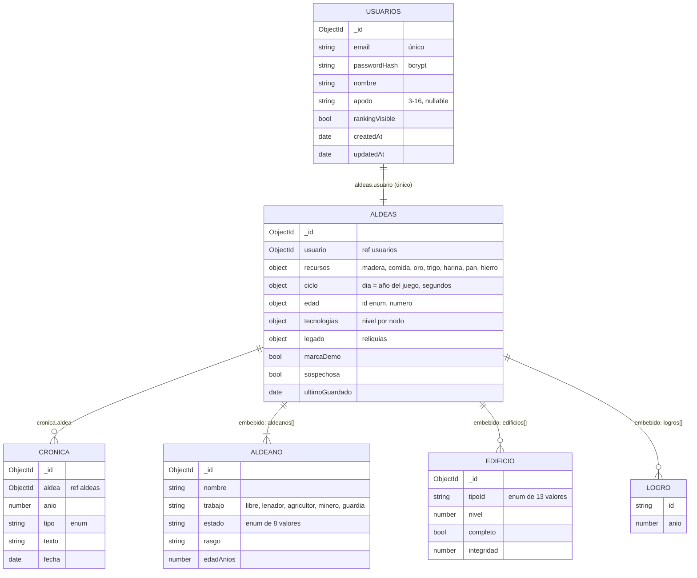

# Vilai · Avance de base de datos NoSQL (Trabajo 3)

**Asignatura:** Bases de Datos Avanzadas · **Estudiante:** Francisco José Kroff Inzunza · **Motor:** MongoDB Atlas (y MongoDB local para pruebas)

Vilai es un juego incremental para móviles: el jugador funda una aldea, sus aldeanos eligen oficio con una IA de utilidad, el tiempo avanza por años, estaciones y edades, y el servidor calcula el progreso mientras la app está cerrada. Este avance describe la base de datos que respalda ese juego: el modelo de datos, la validación, los datos de prueba, las consultas que usa cada pantalla y los índices.

Todo lo que se ejecuta en la base está en [`database/`](../database):

```
database/
├── conexion.js            conexión compartida (lee database/.env)
├── schema/
│   ├── validadores.js     $jsonSchema de usuarios, aldeas y cronica
│   ├── crear-colecciones.js
│   └── prueba-rechazo.js  inserciones inválidas que MongoDB rechaza
├── seed/
│   ├── datos.js           12 usuarios, 12 aldeas y 227 entradas de crónica
│   └── seed.js            carga idempotente (replaceOne + upsert por _id)
├── indexes/indices.js     crea los índices y muestra explain() antes y después
├── queries/consultas.js   15 consultas, cada una asociada a una pantalla
├── .env.example           variables necesarias, sin valores
└── package.json           scripts npm (schema, seed, indices, rechazo, consultas, todo)
```

---

## 1. Motor elegido y justificación

Elegí **MongoDB** (Atlas, plan gratuito, AWS São Paulo) porque coincide con la forma en que Vilai usa sus datos:

- **El dato principal es un documento.** Una partida es *una aldea* con sus recursos, aldeanos, edificios, tecnologías y logros. La pantalla **Aldea** necesita todo eso junto cada vez que se abre la app, y el servidor lo necesita para calcular el **progreso offline** (hasta 8 horas). En MongoDB eso es **una lectura de un documento** (`findOne({ usuario })`). En una base relacional serían al menos 5 tablas (`aldea`, `aldeano`, `edificio`, `tecnologia_aldea`, `logro_aldea`) y 5 `JOIN` o consultas para armar la misma pantalla, y para guardar habría que reescribir filas en todas esas tablas.
- **Consultas más frecuentes.** La app guarda la aldea varias veces por minuto (`PUT /api/aldea`) y la lee al abrir. Las dos operaciones tocan un solo documento, y en MongoDB la escritura de un documento es atómica sin necesidad de transacciones.
- **Uso sin señal.** El juego sigue corriendo en el teléfono con la simulación local y se sincroniza al volver la conexión. Como la aldea viaja como un único JSON, el estado del cliente y el de la base tienen la misma forma: no hay que convertir objetos a filas ni de vuelta.
- **Esquema que evoluciona.** En cada avance se agregaron campos (edades, investigación, logros, estadísticas). En un modelo relacional cada uno habría sido un `ALTER TABLE` con migración obligatoria. En MongoDB se agregan al documento, se validan con `$jsonSchema` y Mongoose, y las aldeas antiguas se migran de forma idempotente.

**Comparación concreta con una base relacional:** asignar un oficio a un aldeano (pantalla **Aldeanos**) es, en SQL, `UPDATE aldeano SET trabajo='minero' WHERE id=? AND aldea_id=?`, y después hay que releer la aldea completa con sus `JOIN` para refrescar el HUD. En MongoDB es un `updateOne` con `arrayFilters` sobre el subdocumento (consulta 5), y el documento resultante ya es exactamente lo que la app muestra.

Lo que se pierde: no hay `JOIN` nativos ni claves foráneas. Por eso las dos relaciones entre colecciones (`aldeas.usuario` y `cronica.aldea`) se protegen con índices (uno de ellos único) y se resuelven con `$lookup` solo donde hace falta (el ranking).

---

## 2. Modelo de datos

El caso de uso principal es **"jugar una partida"**: registrarse, abrir la aldea, administrar aldeanos, construir, investigar y ver el progreso. Para eso hay **3 colecciones**:

| Colección | Qué guarda | Documentos en el seed |
|---|---|---|
| `usuarios` | La cuenta del jugador: email, hash de contraseña y perfil público del ranking | 12 |
| `aldeas` | La partida completa de un usuario, con **aldeanos, edificios, tecnologías y logros embebidos** | 12 |
| `cronica` | El historial de hechos de una aldea (construcciones, llegadas, edades, reliquias, eventos) | 227 |

### Diagrama



### Documentos de ejemplo

Están en formato *Extended JSON* para que se vean los tipos: `$oid` es un `ObjectId` y `$date` es una **fecha real (`Date`)**, no un texto.

**`usuarios`**

```json
{
  "_id": { "$oid": "a10000000000000000000001" },
  "email": "camila.rojas@ejemplo.cl",
  "passwordHash": "$2a$10$8TZT91LDIWGqr06WfLJIwuFPlLzPgF8YA/MemHlVanqR8DWCKXTZq",
  "nombre": "Camila Rojas",
  "apodo": "CamiRoja",
  "rankingVisible": true,
  "ultimoCambioApodo": { "$date": "2026-09-04T14:00:00Z" },
  "createdAt": { "$date": "2026-09-04T12:00:00Z" },
  "updatedAt": { "$date": "2026-11-11T17:00:00Z" }
}
```

**`aldeas`** (recortado a 2 aldeanos y 2 edificios; el documento real tiene 9 y 7)

```json
{
  "_id": { "$oid": "b20000000000000000000001" },
  "usuario": { "$oid": "a10000000000000000000001" },
  "recursos": { "madera": 418, "comida": 324, "oro": 84, "trigo": 126, "harina": 42, "pan": 0, "hierro": 84 },
  "tasasGeneracion": { "madera": 3.6, "comida": 3.2, "oro": 0.1, "trigo": 0.2, "harina": 0.1, "pan": 0.05, "hierro": 0.3 },
  "poblacionMaxima": 11,
  "aldeanos": [
    {
      "_id": { "$oid": "c30000000000000000000065" },
      "nombre": "Aurelio", "x": 51, "y": 67, "edadAnios": 23, "esperanza": 63,
      "trabajo": "agricultor", "modoTrabajo": "manual", "rasgo": "hortelano", "estado": "cultivando",
      "necesidades": { "hambre": 20, "energia": 40, "animo": 50 },
      "pensamientoActual": "Si llueve a tiempo, la cosecha llena el granero.",
      "objetivoEdificioId": null
    },
    {
      "_id": { "$oid": "c30000000000000000000066" },
      "nombre": "Inés", "x": 88, "y": 120, "edadAnios": 30, "esperanza": 68,
      "trabajo": "minero", "modoTrabajo": "automatico", "rasgo": "minero", "estado": "minando",
      "necesidades": { "hambre": 33, "energia": 57, "animo": 61 },
      "pensamientoActual": "Aquí abajo suena a hierro.",
      "objetivoEdificioId": null
    }
  ],
  "edificios": [
    { "_id": { "$oid": "d40000000000000000000065" }, "tipoId": "aserradero", "x": 30, "y": 30, "nivel": 2, "completo": true, "progreso": 100, "integridad": 71 },
    { "_id": { "$oid": "d40000000000000000000066" }, "tipoId": "granja", "x": 91, "y": 73, "nivel": 3, "completo": true, "progreso": 100, "integridad": 80 }
  ],
  "tecnologias": { "herramientas": 3, "logistica": 2, "defensa": 1, "metalurgia": 0, "planosAntiguos": 0 },
  "puntosInvestigacion": 168,
  "legado": { "coloniasFundadas": 0, "reliquias": 3, "reliquiasGastadas": 0, "generaciones": 1 },
  "ciclo": { "dia": 42, "segundos": 55 },
  "edad": { "id": "ceniza", "numero": 4, "inicioAnio": 36, "duracionAnios": 10 },
  "logros": [
    { "id": "primerAldeano", "anio": 1 },
    { "id": "primeraEdad", "anio": 11 },
    { "id": "tresEdades", "anio": 30 },
    { "id": "invernada", "anio": 5 }
  ],
  "marcaDemo": false,
  "sospechosa": false,
  "poblacionRanking": 9,
  "ultimoGuardado": { "$date": "2026-11-11T17:00:00Z" },
  "createdAt": { "$date": "2026-09-04T12:00:00Z" },
  "updatedAt": { "$date": "2026-11-11T17:00:00Z" }
}
```

> `ciclo.dia` significa **año del juego**. El nombre viene de una versión anterior en la que el tiempo avanzaba por días, y no se renombró para no dejar huérfanas las partidas guardadas.

**`cronica`**

```json
{
  "_id": { "$oid": "e500000000000000000003ec" },
  "aldea": { "$oid": "b20000000000000000000001" },
  "anio": 4,
  "tipo": "evento",
  "texto": "Las bestias rondaron la aldea, pero la guardia resistió",
  "fecha": { "$date": "2026-09-04T12:12:00Z" }
}
```

---

### Esquema y validación

La validación se aplica **en la base de datos** con `$jsonSchema` (`validationLevel: strict`, `validationAction: error`) en las 3 colecciones: campos obligatorios, tipos BSON (fechas como `date`, ids como `objectId`), mínimos y máximos, y valores permitidos (`enum`). Además, el backend valida con los esquemas Mongoose de `backend/src/models/`, que usan los mismos nombres de campo y los mismos `enum`. Comprobé que los 24 documentos del seed (usuarios y aldeas) pasan `validateSync()` de esos modelos, así que el Avance N°2 los podrá leer tal cual.

| Colección | Obligatorios | Reglas destacadas |
|---|---|---|
| `usuarios` | email, passwordHash, rankingVisible, createdAt, updatedAt | email con formato de correo; apodo de 3 a 16 caracteres o `null`; fechas tipo `date` |
| `aldeas` | usuario, recursos (los 7), ciclo, edad, aldeanos, edificios, poblacionMaxima, ultimoGuardado, createdAt | recursos ≥ 0; `edad.id` en las 6 edades; cada aldeano con `trabajo`, `estado` y `rasgo` dentro de su `enum`; `tipoId` en los 13 edificios; `esperanza` entre 62 y 82; hasta 200 aldeanos |
| `cronica` | aldea, anio, tipo, texto, fecha | `additionalProperties: false`; `tipo` en 11 valores; texto de 3 a 200 caracteres; `fecha` tipo `date` |

**Prueba de rechazo** (`npm run rechazo`): se intentan 3 inserciones inválidas y MongoDB rechaza las 3 con `Document failed validation (código 121)`, indicando la regla que falló:

1. `cronica` con `anio: "año tres"` (texto en vez de número) y `tipo: "fiesta"` → `type did not match` y `value was not found in enum`.
2. `aldeas` con `madera: -5` y un aldeano con `trabajo: "panadero"` → `comparison failed (minimum 0)` y `value was not found in enum`.
3. `usuarios` sin `passwordHash` y con `createdAt: "2026-11-26"` como texto → `missingProperties: ["passwordHash"]` y `type did not match`.


---

## 3. Decisiones de modelado

La regla que seguí: **se embebe lo que la pantalla lee siempre junto con su dueño y tiene tamaño acotado; se referencia lo que crece sin límite, se lee por separado o pertenece a otra entidad.**

| Dato | Decisión | Por qué |
|---|---|---|
| Aldeanos (`aldeas.aldeanos[]`) | **Embebido** | La pantalla **Aldea** los dibuja en la escena y la pantalla **Aldeanos** los lista: siempre se leen con la aldea. Un aldeano no existe fuera de su aldea. Están acotados por `poblacionMaxima` (decenas, no miles). El servidor los necesita todos juntos para simular el progreso offline. |
| Edificios (`aldeas.edificios[]`) | **Embebido** | Mismo caso: la escena, **Construir** y el cálculo de producción los leen juntos. Construir un edificio y pagar su costo es **un solo `updateOne` atómico** (consulta 6), sin transacción. |
| Tecnologías, recursos, ciclo, edad, legado | **Embebido (subdocumentos)** | Son 1 a 1 con la aldea y pequeños. Separarlos solo agregaría lecturas. |
| Logros (`aldeas.logros[]`) | **Embebido** | Son como máximo 12 (el catálogo es cerrado) y la pantalla **Logros** los lee con la aldea. |
| Usuario ↔ Aldea | **Referenciado** (`aldeas.usuario`, índice único) | La cuenta (email, hash) es un dato sensible que se lee en el login, cuando todavía no se necesita la aldea. La aldea pesa varios KB y se guarda varias veces por minuto: si estuvieran juntas, cada guardado reescribiría también la cuenta. El índice único garantiza la relación 1 a 1. |
| Crónica (`cronica`) | **Referenciada** (`cronica.aldea`), **colección propia** | Es la única parte que **crece sin límite**: cada año se agregan entradas. Hoy, embebida, el servidor tiene que recortarla a 50 (`villageController.js`) para no inflar el documento, que además tiene un límite de 16 MB, y así se pierde la historia. Como colección propia se lee **paginada** (consulta 13), se agrega por tipo (consulta 11) y la aldea, que se guarda varias veces por minuto, sigue siendo liviana. |
| Catálogo de edificios y árbol de investigación | **No se guarda en la base** (módulo descrito) | Son datos fijos del juego, versionados en el código (`villageDefaults.js`) y servidos por `GET /api/catalogo`. Si en el futuro se editan sin publicar una versión nueva, pasarían a una colección `catalogo`. |

**Colecciones de módulos futuros (solo descritas):**

- `catalogo`: tipos de edificio y nodos de investigación, si se vuelven editables.
- `eventos_globales`: eventos compartidos entre aldeas (por ejemplo, un invierno global), referenciados por fecha.

**Lo que no hice a propósito:** no separé aldeanos ni edificios en colecciones propias. Eso sería copiar el modelo relacional (todo referenciado) y obligaría a usar `$lookup` en cada pantalla.

---

## 4. Consultas

Están en [`database/queries/consultas.js`](../database/queries/consultas.js). Se corren todas con `npm run consultas` o una sola con `node queries/consultas.js N`, que es lo que conviene para sacar cada captura. Las consultas 2, 6, 9, 14 y 15 trabajan sobre un jugador **nuevo** que crea la 2 y borra la 15, así se pueden repetir sin alterar los datos del seed.

| N° | Pantalla | Operación | Consulta |
|---|---|---|---|
| 1 | Login | Detalle | `usuarios.findOne({ email })` con proyección |
| 2 | Login (registro) | **Crear** | `insertOne` del usuario + `insertOne` de su aldea inicial con 2 aldeanos embebidos |
| 3 | Aldea (inicio) | **Detalle por id** | `aldeas.findOne({ usuario })` con proyección y `poblacion: { $size: '$aldeanos' }` |
| 4 | Aldeanos | **Listar** con filtro y orden | `aggregate`: `$match` → `$unwind` → `$match trabajo $in [lenador, agricultor]` → `$sort nombre` → `$project` |
| 5 | Aldeanos | **Actualizar** | `updateOne` con `$set 'aldeanos.$[a].trabajo'` y `arrayFilters` |
| 6 | Construir | **Crear** subdocumento + actualizar | `updateOne({ 'recursos.madera': { $gte: 30 } }, { $inc, $push })`: paga y construye de forma atómica; si no alcanza, no cambia nada |
| 7 | Construir | **Agregación** | `$unwind edificios` → `$group` por `tipoId` (cantidad, `$max` nivel) → `$sort` |
| 8 | Investigación | Detalle | `findOne` con proyección de `tecnologias` y `puntosInvestigacion` |
| 9 | Ajustes | **Actualizar** | `usuarios.updateOne` de `apodo` y `rankingVisible` |
| 10 | Ranking | **Agregación con `$lookup`** | `$match` (sin demo ni sospechosas) → `$sort ciclo.dia` → `$lookup usuarios` → `$match rankingVisible` → `$limit 10` → `$project` |
| 11 | Estadísticas | **Agregación** | `cronica`: `$match aldea` → `$group` por `tipo` (`$sum`, `$max`) → `$sort` |
| 12 | Logros | Listar con orden | `$unwind logros` → `$sort anio` |
| 13 | Aldea → Crónica | **Listar** con filtro, orden y paginación | `cronica.find({ aldea, tipo: { $ne: 'evento' } }).sort({ anio: -1 }).skip(0).limit(10)` |
| 14 | Aldeanos | **Eliminar** | `updateOne` con `$pull` del aldeano que fallece + `insertOne` en la crónica |
| 15 | Ajustes | **Eliminar** (borrar cuenta) | `cronica.deleteMany({ aldea })` + `aldeas.deleteOne` + `usuarios.deleteOne` |

### Evidencia

Cada captura muestra la salida de `node queries/consultas.js N` (o la misma consulta en Compass) sobre la base `vilai_bd` en Atlas.

| N° | Captura |
|---|---|
| 1 |  |
| 2 |  |
| 3 |  |
| 4 |  |
| 5 |  |
| 6 |  |
| 7 |  |
| 8 |  |
| 9 |  |
| 10 |  |
| 11 |  |
| 12 |  |
| 13 |  |
| 14 |  |
| 15 |  |

Resultado esperado del ranking (consulta 10), para comparar con la captura:

```json
[
  { "apodo": "AgusMinero",   "anios": 47, "edad": "sombras",    "poblacion": 10, "reliquias": 4 },
  { "apodo": "CamiRoja",     "anios": 42, "edad": "ceniza",     "poblacion": 9,  "reliquias": 3 },
  { "apodo": "Matiaserrin",  "anios": 35, "edad": "hielo",      "poblacion": 8,  "reliquias": 2 }
]
```

Se excluyen `DemoVilai` (por `marcaDemo: true`) y los jugadores con `rankingVisible: false`.

---

## 5. Índices

Los crea [`database/indexes/indices.js`](../database/indexes/indices.js). El script **borra el índice si ya existía**, ejecuta la consulta con `explain('executionStats')`, crea el índice y vuelve a ejecutar el `explain()`. Así el "antes" y el "después" se ven en la misma salida.

| Índice | Colección | Tipo | Consulta que acelera |
|---|---|---|---|
| `email_unico` `{ email: 1 }` | usuarios | Simple, **único** | Consulta 1 (login). Además impide registrar dos cuentas con el mismo correo (regla de integridad, por eso se crea en `schema/`). |
| `aldea_usuario_unico` `{ usuario: 1 }` | aldeas | Simple, **único** | Consulta 3 (abrir la aldea del usuario con sesión). Además garantiza 1 aldea por usuario. |
| `cronica_aldea_anio` `{ aldea: 1, anio: -1 }` | cronica | **Compuesto** | Consultas 13 (crónica paginada), 11 (`$match aldea`) y 15 (`deleteMany`). El orden `anio: -1` coincide con el `sort`, así que no hay que ordenar en memoria. |
| `ranking_anios` `{ marcaDemo: 1, sospechosa: 1, 'ciclo.dia': -1 }` | aldeas | **Compuesto** | Consulta 10 (ranking): filtra por igualdad y ordena por años con el mismo índice (regla igualdad → orden). |

Resultado medido con los datos del seed (227 entradas de crónica, 12 aldeas):

| Índice | Plan **antes** | Docs examinados antes | Plan **después** | Docs examinados después |
|---|---|---|---|---|
| `cronica_aldea_anio` | `SORT ← COLLSCAN` | 227 | `LIMIT ← FETCH ← IXSCAN` | 10 |
| `aldea_usuario_unico` | `COLLSCAN` | 12 | `EXPRESS_IXSCAN` | 1 |
| `ranking_anios` | `SORT ← COLLSCAN` | 12 | `LIMIT ← FETCH ← IXSCAN` | 10 |

Lo importante no son los milisegundos (con tan pocos datos todo tarda menos de 15 ms), sino que **desaparece el `COLLSCAN` y el `SORT` en memoria**: antes se leía la colección completa, ahora solo lo que se devuelve. Con 10 000 aldeas, la crónica sin índice recorrería cientos de miles de documentos por cada página.


---

## 6. Cómo ejecutarlo

Requisitos: **Node.js 20.12 o superior** (el proyecto usa 24) y una base MongoDB (Atlas o local).

**1. Crear la base.** En Atlas: *Database → Connect → Drivers*, copiar la cadena `mongodb+srv://`. Conviene un usuario con rol `readWrite` solo sobre `vilai_bd`. La base y las colecciones se crean solas en el paso 4. Para usar MongoDB local, la cadena es `mongodb://localhost:27017`.

**2. Configurar las variables** (el archivo `database/.env` está en `.gitignore` y nunca se sube):

```powershell
cd database
copy .env.example .env      # en Linux/macOS: cp .env.example .env
```

Luego hay que editar `database/.env` y completar `MONGODB_URI`. `DB_NAME` queda en `vilai_bd`.

**3. Instalar** (solo el driver oficial `mongodb`):

```powershell
npm install
```

**4. Ejecutar todo en orden:**

```powershell
npm run todo
```

Que equivale a ejecutar, uno por uno:

```powershell
npm run schema      # crea las 3 colecciones con $jsonSchema (o las actualiza con collMod)
npm run seed        # carga 12 usuarios, 12 aldeas y 227 entradas de crónica (se puede repetir)
npm run indices     # crea los índices y muestra explain() antes y después
npm run rechazo     # 3 inserciones inválidas, todas rechazadas
npm run consultas   # las 15 consultas; o: node queries/consultas.js 10
```

Todos los scripts se pueden volver a correr: `seed` reemplaza cada documento por su `_id` fijo (si se ejecuta dos veces, sigue habiendo 12, 12 y 227 documentos), e `indices` borra y recrea sus índices. La contraseña de prueba de todos los usuarios del seed es `aldea-de-prueba` y solo existe en esta base de pruebas.

---

## 7. Uso de IA generativa

| Herramienta | Para qué |
|---|---|
| **Claude Code** (modelo Claude Opus 5.5, Anthropic) | Revisar el proyecto contra la rúbrica, proponer el plan, escribir los scripts de `database/` y el borrador de este informe |
| **GitHub Copilot** | Autocompletado mientras revisaba y ajustaba el código |

**Prompts principales:**

1. *"Necesito que revises el proyecto, y de acuerdo a esta rúbrica cambies lo que creas necesario"* (adjuntando la rúbrica en PDF). La IA entregó primero un diagnóstico por criterio y un plan, y no implementó nada hasta que lo aprobé.
2. *"Ok, implementa"*: generación de `database/` (esquema, seed, índices, consultas) y de este informe.

**Qué se corrigió o verificó (no se aceptó tal cual):**

- **Faltaba una tercera colección.** El backend tenía solo `usuarios` y `aldeas`. En vez de inventar una colección, se separó la **crónica**, que ya existía embebida y el servidor recortaba a 50 entradas porque crecía sin límite. Es una decisión de modelado real del proyecto.
- **Tipos numéricos del validador.** Un primer enfoque con `bsonType: "int"` habría rechazado los números que Mongoose guarda como `double`. Se usó `"number"`, que acepta `int`, `long`, `double` y `decimal`.
- **Compatibilidad con el backend.** Se validaron los documentos del seed con los modelos Mongoose reales (`validateSync()`): 0 errores.
- **Salida ilegible para las capturas.** `console.dir` mostraba los `ObjectId` como `{ i0, i1, … }`. Se cambió a `JSON.stringify`, que imprime el id en hexadecimal.
- **Datos incoherentes en el seed.** La crónica de una aldea decía dos veces "Comienza la Edad de Hielo" porque la edad actual no seguía el orden de las edades. Ahora se deriva del orden Calma → Abundancia → Hielo → Ceniza → Sombras → Descubrimientos. También se redondearon las tasas (salía `3.1999999999999997`).
- **El jugador nuevo del registro no tenía `legado`**, así que aparecía en el ranking sin reliquias. Se agregó a la aldea inicial.
- **`.gitignore` de la raíz no ignoraba `.env`** (solo `.env*.local`). Se agregó `.env` y la excepción `!.env.example`, y se revisó el historial de git buscando cadenas `mongodb+srv://` con contraseña: no había ninguna.
- **Pruebas.** Todo el flujo (`npm run todo`, repetir `seed` y repetir `consultas`) se probó contra un MongoDB en memoria (`mongodb-memory-server`, ya instalado en `backend/`) antes de correrlo en Atlas.
